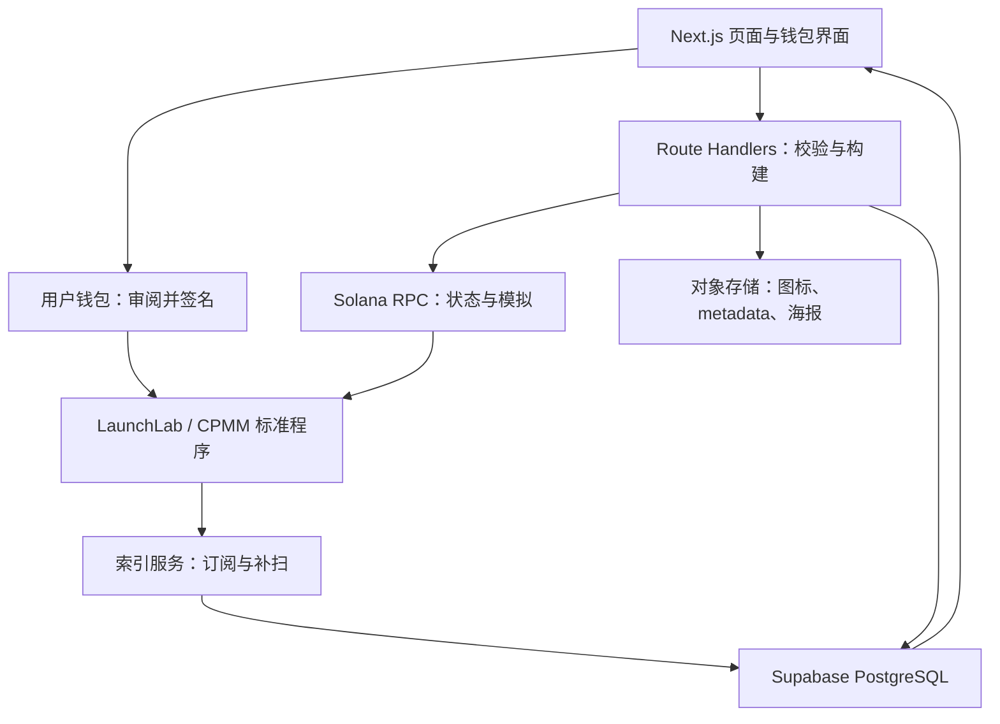
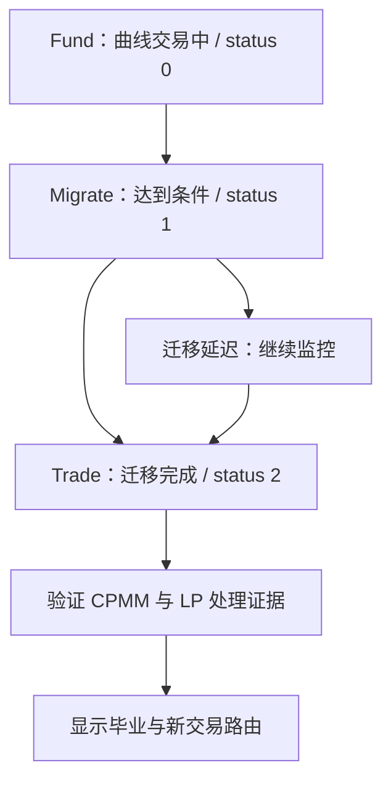

# d00 · StonkLaunch 产品与架构规约

版本：v2.1 · 2026-10-18（Asia/Shanghai）  
状态：规约已完成，待用户通过启动指令确认后由 dot 编码。  
证据依据：[`PROTOCOL_EVIDENCE.md`](PROTOCOL_EVIDENCE.md)。本文中的设计值是产品决策；协议能力须在目标集群验证。

## 1. 产品决定

做 **Solana 自选计价发射台**：创作者用一个连贯流程创建代币与 LaunchLab bonding curve，用户在曲线上买卖，达到条件后由协议迁移到 Raydium CPMM，应用提供完整过程、真实费用与海报分享。

正式对外文案：

> 让你的代币以选定的链上资产交易。从发行到分享，在一个工作台完成。

“计价”指买卖和池子的另一侧资产。它不使新代币获得股票所有权、价格锚定、底层储备或赎回权；法币/商品必须有真实、被协议接受的链上 mint。不能以股票行情 API 代替 quote mint。

### 首发决策

先打通 SOL 的完整全栈真实路径。资产登记和界面完整支持扩展到 USDC/xStocks；每一种候选资产分别验证，不能设置 `enabled=true` 后就算完成。

本次官方配置 API 返回 WSOL、USD1、HeyAnon，没有返回 USDC/xStocks 计价配置。API 不是链上全量支持证明；未返回资产应显示“待验证”，不下永久不支持的断言。暂不引入 USD1/HeyAnon 扩大产品范围。[R3]

**如果非 SOL 路径无法验证，必须报告“SOL 工程闭环成立，多计价卖点尚未实现”。** 不得把扩展接口或不可点击的股票卡片写成“任意资产发币已完成”。

## 2. 用户、任务和可付费价值

第一类用户是有现成社群/受众、希望快速发行可交易代币的创作者；第二类是从分享链接访问并参与的链上用户。平台经营者需要看到自家 launch、费用归属和协议状态。

产品价值具体化为：连续创建与可恢复草稿、透明完整费用、真实状态反馈、发布即有分享物料、买卖与毕业页衔接、所有发行的运营终端。平台通过标准协议的交易费获得收益；不增加发币订阅、彩票或额外支付墙。

初始商业假设是“创作者愿意为发行/传播便利和透明运营持续使用该平台”。这是假设，不因界面华丽或具备收费代码就成立。SOL 首发是工程起点；非 SOL 需求和接入能力共同决定后续差异化。

## 3. 功能范围与核心页面

| 页面 | 首版必须实现的体验 | 后台/链上关联 |
|---|---|---|
| `/` | 一键发币起点、资产卡、新币列表、真实毕业进度、网络/数据状态 | 资产能力和列表缓存，草稿延续 |
| `/launch` | 图标上传、名称/symbol/简介、计价资产、默认曲线参数、高级折叠、费用摘要、签名与失败恢复 | 上传与 metadata、配置核验、标准创建交易 |
| `/token/[mint]` | 曲线行情与买卖、报价/最低收到/完整费用、确认状态、分享 | RPC、官方 Curve 数学、官方买卖 builder |
| `/token/[mint]/graduation` | 目标进度、等待迁移、CPMM 证据、LP 处理事实、毕业交易入口 | 链上状态、CPMM 与 LP Lock/销毁证据 |
| `/terminal` | 全平台/我的发行/费用标签页，筛选、毕业率、原币种收入、领取入口 | PostgreSQL 索引、权限、链上 claim |

从首页填写的信息进入创建页不能丢失。没有 Supabase 凭据时可用明确标注的本地数据适配器演示，但 Supabase 接入、迁移和运行说明仍属于开发范围；不能因此删掉后台。

首页与列表不要求连接钱包；保存到服务端的私人草稿需要认证，公共链上数据与公开 metadata 可读取。创建或交易时再请求钱包，降低早期流失。

### 首版不扩展

不加入自研智能合约、持币转账税、AI 自动下单、跟单/狙击、博彩/轮盘、跨链桥、中心化保管用户本金、TG Mini App 或其他未选中的商业原语。可以实现标准 Solana Action 的“购买”入口；复杂发币输入仍用 Web 页。

## 4. 变现参数与结算

用户给定的本次 LaunchLab 原语没有现成环境变量名。本包固定如下字典；不要套用未选择的 Jupiter `platformFeeBps=80` 或其收款地址。

| 配置 | 默认 | 映射到协议/SDK |
|---|---:|---|
| `LAUNCHLAB_PLATFORM_FEE_BPS` | 50 | `createPlatformConfig.feeRate = 5000` |
| `LAUNCHLAB_CREATOR_FEE_BPS` | 50 | `createPlatformConfig.creatorFeeRate = 5000` |
| `LAUNCHLAB_SHARE_FEE_BPS` | 0 | 所有自家交易 `shareFeeRate = 0`，不另加推荐费 |
| `LAUNCHLAB_PLATFORM_FEE_WALLET` | 操作员填写 | `platformClaimFeeWallet` |
| `LAUNCHLAB_PLATFORM_ADMIN` | 操作员填写 | 创建/更新平台配置的签名者公钥 |
| `LAUNCHLAB_PLATFORM_ID` | 链上创建后填写 | launch 的 `platformId`，不得用假地址 |

统一单位：1 bps = 100 / 1,000,000；50 bps = 5000 / 1,000,000 = 0.5%。协议 `tradeFeeRate` 必须读取，不作为可修改的产品默认值。[R1][R2][R4]

当前 WSOL 配置为 `tradeFeeRate=2500`，所以商业目标合计：

| 收费部分 | 比例 |
|---|---:|
| Raydium 协议 | 0.25%（本次 API 观察值） |
| StonkLaunch | 0.50% |
| 发币者 | 0.50% |
| 推荐费 | 0.00% |
| 合计交易费 | **1.25%** |

以没有转账税的 1 SOL 买入为算术示例：交易费 0.0125 SOL，其中平台 0.005、创作者 0.005、协议 0.0025；进入曲线计算的金额约 0.9875 SOL。网络费、优先费、首次 ATA/rent 等另列。该示例不是执行报价；实际买卖用官方曲线算法、整数舍入和链上账户状态。

金额必须用 BN/bigint/十进制定点处理。费用分母相同并不表示可以买卖共用一个粗略百分数公式：卖出从曲线算出的 quote proceeds 计算，不对 base token 数量按 SOL 费率直接相乘。

### 真正拿到平台费的链路

平台配置创建并回读 → 自家 launch 显式绑定该 `platformId` → 买卖按真实 pool/config 构建 → 费用在标准协议账户累积 → 领取钱包调用官方 claim → 确认收款账户到账。

`buyToken` 的本地 `platformFeeRate` 参数并不能改变外部池的平台归属。不能在 UI 加一个 0.5% 数字就宣布收费成功。[R4]

`.env` 更换地址/费率先产生期望配置；管理页构建标准更新交易，由管理员签名，确认后回读生效。未经确认的差异显示 `CONFIG_MISMATCH`，不得虚报修改成功。

平台收入随 quote mint 结算。SOL 曲线收入是 SOL/WSOL 口径；将来 xStocks 曲线收入也会是相应 quote token。标准兑换为 USDC/SOL 可另做收入管理功能，本轮不自动兑换、也不把美元估值写成已收 USDC。

毕业后的 CPMM 费用与权利由实际 CPMM/LP 配置决定，不能继承曲线的 0.5%/0.5% 宣传。首次财务模型只依赖已验证的曲线平台费；毕业后利润独立记账。

## 5. 全栈架构

图中资金流仅发生在钱包与标准协议账户之间。数据库保存状态副本和作品资料，不记成用户资金账户。后端构建交易，不持有用户资金签名密钥。

### 技术选择

采用 Next.js 15 App Router 最新受支持安全补丁、TypeScript、Tailwind、shadcn/ui、Lucide、Framer Motion、Supabase/PostgreSQL、官方 Raydium SDK、Solana 标准钱包连接。根任务锁定精确依赖与 lockfile，避免子任务自行升版本。

按官方支持页，2026-10-18 的 Next.js 15 属于 Maintenance LTS，14 已不支持；15 的两年支持窗口接近结束。故在用户指定的 14/15 中选 15，启动/发布当天重新核对支持状态。若届时必须升到 16，先形成明确 d00 修订，不偷偷更换技术栈。[N1]

默认部署拓扑：一个真实 Node/Next 服务 + Supabase + 一个可重复运行的索引任务。已有可用托管环境就复用；没有凭据先做本地可运行工程与部署配置。纯静态托管不满足 Route Handlers、服务端密钥、数据库写入与索引要求。[N2]

## 6. 状态机与真实性

创建流程：`draft → validating → awaiting_signature → submitted → confirmed`；拒签回到保留输入的草稿；广播超时为 `confirmation_unknown`，先查原交易和 mint，不能直接再次创建。

交易流程：`quoting → ready → awaiting_signature → submitted → confirmed/failed/unknown`。价格/账户变化、过期 blockhash 或配置变化都要重新报价与审阅。

毕业流程：

达到条件不等于已迁移；`status` 的任意变化也不等于毕业。Raydium 指定迁移钱包执行标准迁移，应用没有自创 `graduate()` 按钮权限。[R5][R6]

LP 可以涉及销毁、协议锁定及 Fee Key 权利，展示账户、比例与验证时间。不将“存在 CPMM 池”推导为“全部流动性永久锁定”；不把锁 LP 理解为持币者没有价格风险。新旧 LP 分配规则存在版本冲突，执行时见证据文件。

## 7. 两个心理闭环

**降低行动摩擦**：首页预填 → 默认参数 → 一处费用摘要 → 钱包确认 → 即时状态反馈。一个连续流程可以包含多笔真实交易，不能保证钱包只弹一次签名。拒签/断网恢复草稿，不反复重填。

**可验证的社交展示**：链上创建成功 → 诞生海报 → 下载/预填 X 编辑器 → 分享链接访问 → 新用户创建或交易。海报包含计价资产、网络、真实 mint/曲线地址和二维码。打开编辑器不等于已经发推；不自动替用户发送。

这两项以减少摩擦与表达身份为目的，不制造假倒计时、假交易流水、假收益、隐藏费用或“包赚”暗示。具体视觉见 `UI_AND_GROWTH.md`。

## 8. 商业验收口径

分别记录 `estimated`、`accrued`、`claimable`、`claimed`；只有 confirmed/finalized 证据支持相应真实阶段。费用币种不同先分账；USD 估值必须有价格来源和时间，缺价格不能默认为 1 美元。

条件测算：若有效 SOL 折算成交额为 10,000 美元、平台实际获得 0.5%，毛费用约 50 美元；10 万对应约 500 美元。该测算不是预测，不证明需求，也不扣除 RPC、存储、服务器和平台承担的链上成本。

第一轮增长目标仅作为内部假设：5 名有自身受众的目标创作者访谈，3 人独立完成创建可用性验证，2 人使用分享物料，并验证至少一个人真正需要非 SOL 计价。联系/邀请/公开发布由用户另行授权；工程阶段交付埋点和物料即可。

## 9. 本轮完成标准

d00 完成表示上述产品决策、架构、费率和验收口径已可审阅。后续只运行 d01–d04，按五个原门禁报告；不存在“文档齐就全部 PASS”。

若真实主网签名或协议支持尚缺，交付完整可审阅工程、可运行入口与精确阻塞，不说已收费或已上线。多计价能力、主网能力和运营收入分别报告，避免用 SOL 演示偷换原始卖点。

来源索引 R1–R6、N1–N2 的完整链接、观察范围与版本冲突见 `PROTOCOL_EVIDENCE.md`。
